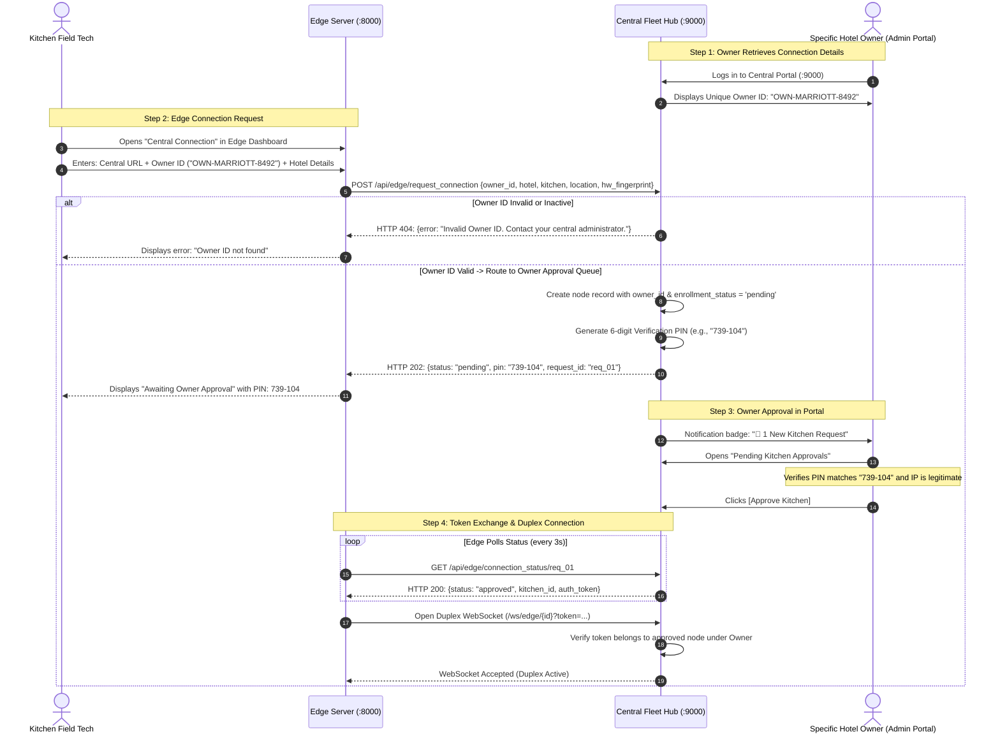

# Multi-Tenant Secure Edge Onboarding & Owner Isolation Protocol Specification

**Document Version**: 3.0  
**Target Systems**: `Smart-hotel-monitoring-system` (Edge) & `SHMS_central_server` (Central)  
**Security & Architecture Model**: Multi-Tenant Zero-Trust Edge Onboarding with Cryptographic Owner Isolation

---

## 1. Problem Statement & Multi-Tenant Requirement

### The Multi-Owner Challenge
The Central Monitoring Server is an **Enterprise Multi-Tenant SaaS platform**. It serves multiple independent hotel owners, franchise operators, and restaurant groups simultaneously (e.g., "Marriott International", "Taj Hospitality", "Urban Kitchens Ltd").

### Hard Isolation Invariant
1. **Strict Tenant Separation**: An edge device belonging to *Owner A* must **never** be visible to, managed by, or accessible from *Owner B's* dashboard.
2. **Targeted Connection Routing**: When a kitchen edge server requests a connection to Central, it must provide a verified **Unique Owner ID (Tenant ID)** so Central routes the connection request specifically to that owner's approval queue.
3. **Owner-Scoped RBAC**: All fleet telemetry, live snapshots, violation ledgers, evidence snapshots, and executive PDF audit certificates must be strictly scoped by `owner_id`.

---

## 2. Multi-Tenant Architecture & Owner ID Model

### Owner ID Structure & Lifetime
* **Format**: `OWN-<SLUG>-<HEX8>` (e.g., `OWN-MARRIOTT-4A7F9B12` or UUID-based `own_7f8a912b3c4d5e6f`).
* **Generation**: Generated automatically when an owner/admin signs up or is provisioned by the platform superadmin.
* **Visibility**: Prominently displayed in the Central Fleet Portal top navbar and Settings tab with a **[Copy Connection ID]** button.

```text
┌────────────────────────────────────────────────────────────────────────┐
│ Central Platform (Multi-Tenant Hub :9000)                              │
│                                                                        │
│   Owner 1: "Grand Heritage Group"        Owner 2: "Bistro Fleet Corp"  │
│   Owner ID: OWN-HERITAGE-84192           Owner ID: OWN-BISTRO-10943    │
│   ├─ Kitchen A (Floor 1)                 ├─ Kitchen X (Main Prep)      │
│   ├─ Kitchen B (Bakery)                  └─ Kitchen Y (Dishwashing)    │
│   └─ Pending Approvals Queue             └─ Pending Approvals Queue    │
└───────────────────────────────────┬────────────────────────────────────┘
                                    │
                                    │ POST /api/edge/request_connection
                                    │ { owner_id: "OWN-HERITAGE-84192", ... }
                                    │
                       ┌────────────┴─────────────┐
                       │ Edge Kitchen Appliance   │
                       │ (Ground Floor Prep CCTV) │
                       └──────────────────────────┘
```

---

## 3. End-to-End Multi-Tenant Enrollment Handshake



---

## 4. Database Schema Additions (Multi-Tenant Isolation)

### Central Database (`SHMS_central_server/database.py`)

#### 1. New Table: `owners` (Tenants)
```sql
CREATE TABLE IF NOT EXISTS owners (
    id TEXT PRIMARY KEY,                 -- e.g. "OWN-MARRIOTT-8492"
    company_name TEXT NOT NULL,          -- e.g. "Marriott International Inc"
    contact_email TEXT NOT NULL,
    status TEXT DEFAULT 'active' CHECK(status IN ('active', 'suspended', 'trial')),
    max_kitchens INTEGER DEFAULT 20,
    created_at TIMESTAMP DEFAULT CURRENT_TIMESTAMP
);
CREATE INDEX IF NOT EXISTS idx_owners_status ON owners(status);
```

#### 2. Update `admin_users` table
Associate admin accounts with an owner:
```sql
ALTER TABLE admin_users ADD COLUMN owner_id TEXT REFERENCES owners(id) ON DELETE CASCADE;
ALTER TABLE admin_users ADD COLUMN is_superadmin INTEGER DEFAULT 0;
```

#### 3. Update `edge_nodes` table
Bind every edge node directly to an owner:
```sql
ALTER TABLE edge_nodes ADD COLUMN owner_id TEXT NOT NULL REFERENCES owners(id) ON DELETE CASCADE;
ALTER TABLE edge_nodes ADD COLUMN enrollment_status TEXT DEFAULT 'pending' 
    CHECK(enrollment_status IN ('pending', 'approved', 'rejected', 'revoked'));
ALTER TABLE edge_nodes ADD COLUMN pairing_pin TEXT;
ALTER TABLE edge_nodes ADD COLUMN approved_by TEXT;
ALTER TABLE edge_nodes ADD COLUMN approved_at TIMESTAMP;
ALTER TABLE edge_nodes ADD COLUMN rejection_reason TEXT;

CREATE INDEX IF NOT EXISTS idx_edge_nodes_owner ON edge_nodes(owner_id, enrollment_status);
```

#### 4. Update `fleet_violations` table
Bind violations to `owner_id` for zero-leak queries:
```sql
ALTER TABLE fleet_violations ADD COLUMN owner_id TEXT REFERENCES owners(id) ON DELETE CASCADE;
CREATE INDEX IF NOT EXISTS idx_violations_owner ON fleet_violations(owner_id, timestamp);
```

#### 5. Update `pairing_codes` table
Pre-shared pairing codes are strictly owner-scoped:
```sql
CREATE TABLE IF NOT EXISTS pairing_codes (
    code TEXT PRIMARY KEY,               -- e.g. "849201"
    owner_id TEXT NOT NULL REFERENCES owners(id) ON DELETE CASCADE,
    hotel_name TEXT NOT NULL,
    kitchen_name TEXT,
    created_by TEXT NOT NULL,
    created_at TIMESTAMP DEFAULT CURRENT_TIMESTAMP,
    expires_at TIMESTAMP NOT NULL,
    used INTEGER DEFAULT 0,
    used_by_edge_id TEXT,
    used_at TIMESTAMP
);
CREATE INDEX IF NOT EXISTS idx_pairing_owner ON pairing_codes(owner_id, code, used);
```

---

## 5. API Endpoint Specifications

### Edge-Facing Ingestion Endpoints

#### `POST /api/edge/request_connection`
Must supply `owner_id`. If invalid or suspended, fails with HTTP 403.

* **Request Payload**:
```json
{
  "owner_id": "OWN-MARRIOTT-8492",
  "hotel_name": "Grand Palace Hotel",
  "kitchen_name": "Prep Station 1",
  "location": "Main Kitchen - Ground Floor",
  "api_url": "http://192.168.1.50:8000",
  "hardware_fingerprint": "a1b2c3d4e5f6...",
  "pairing_code": "849201" // Optional
}
```

* **Validation Rules**:
  1. Check `owners` table where `id = owner_id AND status = 'active'`. If not found, reject with HTTP 403: `"Owner ID is invalid or account is suspended"`.
  2. If `pairing_code` supplied, verify code belongs to that `owner_id`. If valid, mark `approved` immediately.
  3. If no pairing code, create node under `owner_id` with `enrollment_status = 'pending'`, generate 6-digit PIN, and return HTTP 202.

---

### Owner / Admin Protected Endpoints (Scoped by Session `owner_id`)

All fleet endpoints automatically filter by the logged-in user's `owner_id`:

#### 1. `GET /api/fleet/owner_info`
Returns the logged-in owner's identity, unique connection ID, and subscription limits.

* **Response**:
```json
{
  "owner_id": "OWN-MARRIOTT-8492",
  "company_name": "Marriott International Inc",
  "total_kitchens": 6,
  "max_kitchens": 20,
  "onboarding_instruction": "Enter this Owner ID in your Edge Kitchen Settings to connect new cameras."
}
```

#### 2. `GET /api/fleet/enrollment/pending`
Returns ONLY connection requests targeted to this owner:
```sql
SELECT * FROM edge_nodes WHERE owner_id = :session_owner_id AND enrollment_status = 'pending'
```

#### 3. `POST /api/fleet/enrollment/{request_id}/approve`
Ensures the admin can only approve kitchens belonging to their own `owner_id`:
```sql
UPDATE edge_nodes 
SET enrollment_status = 'approved', auth_token = :new_token, approved_by = :admin_user, approved_at = CURRENT_TIMESTAMP
WHERE id = :request_id AND owner_id = :session_owner_id
```

#### 4. `POST /api/fleet/pairing_codes`
Generates a pre-shared pairing code tied to this owner:
```json
{
  "hotel_name": "Grand Palace Hotel",
  "kitchen_name": "Bakery",
  "expiry_minutes": 60
}
```

---

## 6. UI & UX Design Specifications

### 1. Edge Dashboard: `CentralConnectModal.jsx`

Add the **Owner ID** as the very first mandatory field:

```text
┌────────────────────────────────────────────────────────────────┐
│ ☁️ Central Fleet Connection                                     │
│ Connect this kitchen to your centralized enterprise dashboard  │
├────────────────────────────────────────────────────────────────┤
│                                                                │
│  Central Hub URL                                               │
│  [ http://127.0.0.1:9000                                     ] │
│                                                                │
│  Owner / Organization ID * (Get this from your Central portal)  │
│  [ OWN-MARRIOTT-8492                                         ] │
│                                                                │
│  Hotel / Branch Name                                           │
│  [ Grand Palace Hotel & Suites                               ] │
│                                                                │
│  Kitchen Facility Name                                         │
│  [ Main Kitchen - Cold Prep Area                             ] │
│                                                                │
│  Facility Location / Floor                                     │
│  [ Ground Floor - Bay 2                                      ] │
│                                                                │
│  ▶ Optional: Pre-Shared Pairing OTP Code                       │
│  [                                                           ] │
│                                                                │
│  [ Request Connection & Authorize ]                            │
└────────────────────────────────────────────────────────────────┘
```

When submitted without an OTP:
* Displays an animated waiting screen with the **Verification PIN: 739-104**.
* Displays subtext: *"Awaiting approval from the administrator of OWN-MARRIOTT-8492."*

---

### 2. Central Fleet Portal: Top Navigation & Approvals Drawer

1. **Owner ID Pill in Central Navbar**:
   * A prominent pill next to the admin profile:
     ```text
     ┌──────────────────────────────────────────────┐
     │ 🏢 Marriott International                    │
     │ ID: OWN-MARRIOTT-8492  [📋 Copy ID]          │
     └──────────────────────────────────────────────┘
     ```
   * Clicking **[Copy ID]** copies `OWN-MARRIOTT-8492` to the clipboard with a toast notification.
2. **Pending Kitchen Requests Notification Badge**:
   * Pulsing amber counter: `🔔 1 Pending Kitchen`.
   * Clicking opens the **Owner Approval Drawer**:
     * Shows: Requested Kitchen Name, Hotel Branch, Remote IP, and **Verification PIN: 739-104**.
     * Buttons: **[Approve & Connect]** (Emerald) / **[Reject]** (Crimson).

---

## 7. Migration & Backward Compatibility Guardrails

1. **Default Tenant for Existing Nodes**:
   * A default owner `OWN-DEFAULT-SYSTEM` (`"Default Hotel Management"`) is created automatically during migration.
   * Any existing unassigned edge nodes in the database are assigned to `OWN-DEFAULT-SYSTEM` so current setups keep working without broken foreign keys.
2. **Superadmin Role**:
   * An administrator with `is_superadmin = 1` can toggle between different hotel owner views or provision new hotel organizations.
3. **Session Token Context**:
   * HMAC session tokens in `auth.py` are upgraded to include the `owner_id` claim:
     `{"user": "admin", "role": "owner_admin", "owner_id": "OWN-MARRIOTT-8492", "exp": ...}`.

---

## 8. Implementation Checklist for OpenCode

- [ ] **Database Multi-Tenant Migration (`SHMS_central_server/database.py`)**:
  - Create `owners` table with auto-seeding of `OWN-DEFAULT-SYSTEM`.
  - Add `owner_id` to `admin_users`, `edge_nodes`, `fleet_violations`, and `pairing_codes`.
  - Scope all queries (`list_nodes`, `list_violations`, `get_fleet_kpis`, `get_analytics`) by `owner_id`.
- [ ] **Central Server Routes (`SHMS_central_server/server.py`)**:
  - Update `POST /api/edge/request_connection` to validate `owner_id`.
  - Add `GET /api/fleet/owner_info` to provide the current tenant ID to the frontend.
  - Update `POST /api/fleet/enrollment/{id}/approve` to enforce tenant ownership.
  - Include `owner_id` in session token verification (`auth.py`).
- [ ] **Edge Sync Manager (`Smart-hotel-monitoring-system/edge_sync.py`)**:
  - Persist `owner_id` in edge settings (`db.get_setting("owner_id")`).
  - Pass `owner_id` in the enrollment handshake payload.
- [ ] **Edge Frontend (`CentralConnectModal.jsx`)**:
  - Add mandatory **Owner / Organization ID** input field with validation.
- [ ] **Central Frontend (`SHMS_central_server/frontend/`)**:
  - Add Owner ID badge with Copy button to the top navbar.
  - Implement the "Pending Kitchen Approvals" review drawer with PIN verification.
